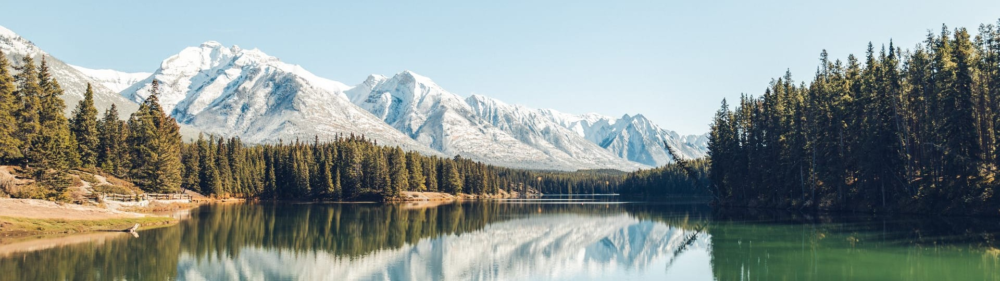

  

<h1 align="center">Owen Rempel</h1>

  <b>I build the software that runs farms, yards and fleets.</b> 
  Full-stack developer and landscape photographer in Calgary, AB.

  <a href="https://owenrempel.ca">Website</a> ·
  <a href="https://owenrempel.ca/#contact">Get in touch</a> ·
  <a href="https://linkedin.com/in/owenrempel">LinkedIn</a> ·
  <a href="https://norlight.photography">Photography</a> ·
  <a href="https://youtube.com/c/OwenRempel">YouTube</a>

---

### What I'm building

Most of my current work lives in private repos, so here is the short version.

<table>
  <tr>
    <td>🐄 <b>Cattle &amp; feedlot management</b> Herd records, feedlot tracking and stats, with data entry that stays quick in the real world. Grew out of <a href="https://github.com/OwenRempel/Hooves">Hooves</a>.</td>
    <td nowrap>Live</td>
  </tr>
  <tr>
    <td>🚛 <b>Safety, fleet &amp; asset management</b> Multi-tenant, with row-level security and an audit trail on everything. Zero to production in about two months.</td>
    <td nowrap>In production</td>
  </tr>
  <tr>
    <td>🌲 <b>CRM + ERP for a tree farm</b> Customers, inventory, stock tracking and invoicing, billed through the QuickBooks Online API. Realtime React front end, C# back end, Postgres.</td>
    <td nowrap>In development</td>
  </tr>
  <tr>
    <td>⛽ <b>Fuel pump control</b> Unlock a pump from the web app, log every litre automatically, fall back to PINs when the internet drops. Arduino Opta in a heated box.</td>
    <td nowrap>In design</td>
  </tr>
  <tr>
    <td>🗂️ <b>Kanban board</b> Written from scratch, because of course.</td>
    <td nowrap>In daily use</td>
  </tr>
</table>

### Stack

<table>
  <tr><td><b>Front end</b></td><td>React, Tailwind CSS, WebSockets</td></tr>
  <tr><td><b>Back end</b></td><td>C#, Node.js, PHP, Python</td></tr>
  <tr><td><b>Data</b></td><td>PostgreSQL, SQL</td></tr>
  <tr><td><b>Infra</b></td><td>Linux, Docker Compose, DigitalOcean, Cloudflare, GitHub Actions</td></tr>
  <tr><td><b>Hardware</b></td><td>Arduino Opta, drones</td></tr>
</table>

### How I work

I like owning a system end to end: the database, the API, the interface and the server it runs on. I lean heavily on AI coding tools to move fast, and I stay close to the details so that what ships is something people actually want to use.

### Behind the camera

I shoot landscapes, portraits and the occasional wedding as [Norlight Photography & Cinema](https://norlight.photography), and I co-founded Northstory Creative, which does web, photo and video for nonprofits, schools and faith organizations. The banner up top is one of mine. Prints are in the [store](https://norlightphotography.pixieset.com).
