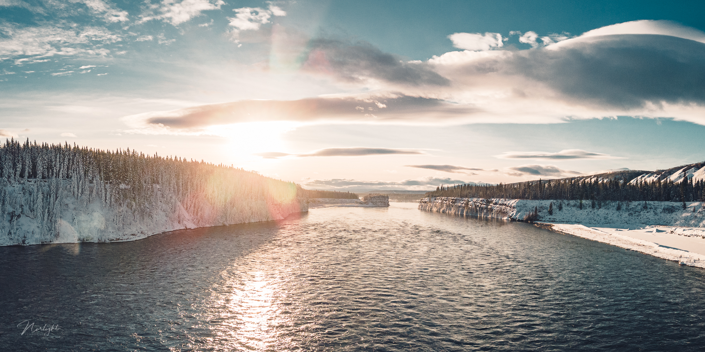

  

<h1 align="center">Owen Rempel</h1>

  <b>I build the software that runs farms, yards and fleets.</b> 
  Full-stack developer and landscape photographer in Calgary, AB.

  <a href="https://owenrempel.ca">Website</a> ·
  <a href="https://owenrempel.ca/#contact">Get in touch</a> ·
  <a href="https://linkedin.com/in/owenrempel">LinkedIn</a> ·
  <a href="https://norlight.photography">Photography</a> ·
  <a href="https://youtube.com/c/OwenRempel">YouTube</a>

---

### What I'm building

Most of my current work lives in private repos, so here is the short version.

| | Project | Status |
|---|---|---|
| 🐄 | **Cattle & feedlot management** Herd records, feedlot tracking and stats, with data entry that stays quick in the real world. Grew out of [Hooves](https://github.com/OwenRempel/Hooves). | Live System |
| 🚛 | **Safety, fleet & asset management** Multi-tenant, with row-level security and an audit trail on everything. Zero to production in about two months. | In production |
| 🌲 | **CRM + ERP for a tree farm** Customers, inventory, stock tracking and invoicing, billed through the QuickBooks Online API. Realtime React front end, C# back end, Postgres. | In development |
| ⛽ | **Fuel pump control** Unlock a pump from the web app, log every litre automatically, fall back to PINs when the internet drops. Arduino Opta. | In design |
| 🗂️ | **Kanban board** Written from scratch, because of course. | In daily use |

### Stack

| | |
|---|---|
| **Front end** | React, Tailwind CSS, WebSockets |
| **Back end** | C#, Node.js, PHP, Python |
| **Data** | PostgreSQL, SQL |
| **Infra** | Linux, Docker Compose, DigitalOcean, Cloudflare, GitHub Actions |
| **Hardware** | Arduino Opta, drones |

### How I work

I like owning a system end to end: the database, the API, the interface and the server it runs on. I lean heavily on AI coding tools to move fast, and I stay close to the details so that what ships is something people actually want to use.

### Behind the camera

I shoot landscapes, portraits and the occasional wedding as [Norlight Photography & Cinema](https://norlight.photography), and I co-founded Northstory Creative, which does web, photo and video for nonprofits, schools and faith organizations. The banner up top is one of mine. Prints are in the [store](https://norlightphotography.pixieset.com).

---

⚡ Stop signs used to be yellow.

